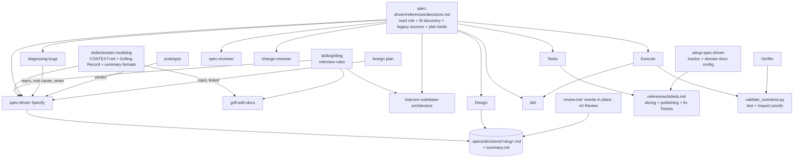

# Integrate Skills Design

**Spec**: `.specs/features/integrate-skills/spec.md`
**Grilling Record**: `.specs/decisions/grill-in-spec-driven.md` (Design section: D-grill-in-spec-driven.38 to .41; Review section: .42 to .47)
**Status**: Draft (revised after Spec Review SR1)

---

## Architecture Overview

The repository is a library of prompts plus a few deterministic scripts. Each rule gets one home, and every other file links to it.



Flow after the change:

```
Specify (grill) → Design (Medium+) → Tasks + Tickets (always) → /spec-review → Dispositions
   → ["publish tickets", optional] → Execution Approval → Execute (tdd loop per Task, test proofs only)
   → Verifier (all Scenarios, one row each in validation.md's Scenario-Anchored table) → /code-review (human)
```

---

## Code Reuse Analysis

### Reuse Table (one row per planned component)

| Planned component | Searched (terms / queries) | Nearest existing equivalent | Decision | Why |
| --- | --- | --- | --- | --- |
| `skills/grilling/SKILL.md` | `symbols --match grill,session,interview`; `rg -n grilling` | synced `anthropic-skills:grilling` (not in repo) | Reuse (vendor) + Extend | add the two escapes and the Binds rule |
| `domain-modeling/GRILLING-RECORD-FORMAT.md` | `symbols --match decision,adr,record,summary`; `rg -n ADR` | `skills/domain-modeling/ADR-FORMAT.md` | Replace | its one-paragraph rule is the cause of tiny files |
| `spec-driven/references/decisions.md` | `symbols --match discover,scan,listing,tree`; `rg -n "AD-NNN\|docs/adr"` | `memory.md` Decisions section; scattered ADR read lines in 6 skills; `setup-matt-pocock-skills/domain.md:9` (per-context ADRs) | New (consolidates) | one read rule instead of ten copies |
| Specify grill flow in `specify.md` | `rg -n "Discuss\|pace"` | `references/discuss.md`, `specify.md` step 1 | Extend `specify.md`, delete `discuss.md` | Discuss folds into the grill |
| `spec-driven/references/tickets.md` | `symbols --match ticket,tracker,issue,publish`; `rg -n "to-tickets"` | `skills/to-tickets/SKILL.md` | Move + Extend | keep vertical slices, expand–contract and per-tracker shapes; resize to one day; add retry rules; drop `ready-for-agent` |
| `setup-spec-driven` | `rg -n setup-matt-pocock` | `skills/setup-matt-pocock-skills/` | Rename + trim | drop triage labels, ADR wording |
| `inspect` proofs in `validate_scenarios.py` | read `validate_scenarios.py`, `scenarios_lib.py` `parse_spec` | missing-test check | Extend | a `**Proof**: inspect` line after a Scenario switches its proof from a test to a `validation.md` row |
| Ticket checks in `validate_tasks.py` | read `validate_tasks.py` | `parse_tasks`, `check` | Extend | a second pass over a `## Tickets` section; legacy plans warn |
| Plan-file gate, snapshot and foreign plans in `prep_review.py` | read `prep_review.py:206-260` | `prep_spec`, plan list at `:212` | Extend | add paths, add two STOP checks, list records, accept a foreign plan path |
| Section rename and cell check in `validate_spec.py` | read `validate_spec.py:44-60,196-225` | `REQUIRED_SECTIONS`, assumptions table check at `:203-210` | Extend | rename, require for native specs, find tables by header names, accept `none` |
| Retired-skill removal in `install.sh` | `symbols --match retire,retired,install` → none; read `install.sh:13,24-28` | `RETIRED_SKILLS` loop | Extend | longer list, provenance check before deleting, fd warning |
| `tests/` | `find . -name 'test_*.py'` → none; `python3 -m pytest` → not installed | none | New | stdlib `unittest`, fixture repositories in temp dirs built from `.md` files under `tests/fixtures/`, real graphify (D-grill-in-spec-driven.38) |

### Integration Points

| System | Integration Method |
| --- | --- |
| Claude Code | skills copied to `~/.claude/skills/` by `install.sh`; reviewer agents rendered by `render-adapters.js` |
| opencode | reads `~/.claude/skills/`; agents and `/spec-review`, `/code-review` commands rendered by `render-adapters.js` (unchanged) |
| omp | reads `~/.claude/` files; Specify's sibling-path fallback covers skill loading |
| Issue trackers | `references/tickets.md` reads `docs/agents/issue-tracker.md` written by `setup-spec-driven` (GitHub `gh`, GitLab `glab`, local markdown, or a freeform description) |
| graphify | required by `prep_review.py` and by the tests; `graphify-out/` is never deleted (D-grill-in-spec-driven.46) |

---

## Components

### `skills/grilling/` (new, vendored)

- **Purpose**: the interview primitive: one question per turn, a recommendation per question, facts looked up and decisions asked.
- **Location**: `skills/grilling/SKILL.md`, `skills/grilling/agents/openai.yaml`
- **Interfaces**: called by name by Specify, Design, `grill-with-docs` and `improve-codebase-architecture`.
- **Adds**: "you decide" records the recommendation as `Decided by: agent`; "decide the rest" lists every remaining default in one turn; each recommendation states its proposed Binds.

### `skills/domain-modeling/` (changed)

- **Purpose**: owns the glossary format and the Grilling Record and `summary.md` formats; writes them during any grill.
- **Location**: `SKILL.md` rewritten; `GRILLING-RECORD-FORMAT.md` new (record template plus `summary.md` template); `ADR-FORMAT.md` deleted; `CONTEXT-FORMAT.md` unchanged.
- **Interfaces**: called by name with `grilling`. The record template spells out completeness rules in prose (D-grill-in-spec-driven.6): every section required; the Session path lists every option offered, including rejected ones and retries; one choice per Decision; every Decision has a trade-off; and "a record shorter than its session is wrong". It also states the slug rule (D-grill-in-spec-driven.7), the `draft` status and resume rule (D-grill-in-spec-driven.11), and the rewrite-in-place rule with its `Changed` line (D-grill-in-spec-driven.15).

### `skills/spec-driven/references/decisions.md` (new)

- **Purpose**: the read rule, discovery, legacy sources, plan kinds and Binds test, in one place (D-grill-in-spec-driven.41).
- **Interfaces**: linked from `specify.md`, `design.md`, `tasks.md`, `implement.md`, `standards.md` §1, both agents, `tdd`, `diagnosing-bugs`, `improve-codebase-architecture`, `domain-modeling`.
- **Contents**: the two fd commands; the "fd missing: stop and ask" rule; the `summary.md` row filter (`active` only; `draft` skipped); the header fallback when `summary.md` is broken; legacy sources (`STATE.md ## Decisions`, root `docs/adr/`, per-context `docs/adr/` via `CONTEXT-MAP.md` or `fd -t d -p 'docs/adr$'`, and the current feature's `context.md` whenever it exists); how to tell native, legacy and foreign plans apart (D-grill-in-spec-driven.43); "cite outside sources used in the record's Context".

### spec-driven phase references (changed)

- `SKILL.md`: flow line, auto-sizing table (Tasks at every scope, Design at Medium+), `.specs` tree (`decisions/`, `reviews/<plan slug>/`, no new `context.md`), commands table (publish tickets; Discuss removed), Critical Rules (implementation only through spec-driven; Tickets published only on go-ahead; foreign plans never edited; `graphify-out/` never deleted).
- `specify.md`: pre-question steps (lessons, `decisions.md` read rule, capability search, Standards); calls `grilling` + `domain-modeling`, with the sibling fallback; draft record created at the first answer and resumed if found; dimensions sweep as closing branches; spec template with `## Decisions & Assumptions` (`ID | Decision | Choice | Rationale | Decided by | Binds`), a `**Grilling Record**:` line, a `**Proof**:` line under each Scenario, Deferred Ideas in Out of Scope and optional `## References`; Small template gains Decisions & Assumptions; a foreign plan as input (D-grill-in-spec-driven.44).
- `discuss.md`: deleted.
- `design.md`: required at Medium+; reads via `decisions.md`; grill-style questions; `## Design` section in the record; Tech Decisions as links; changing another record's Decision rewrites it there.
- `tasks.md`: never skipped; top-down Ticket slicing (D-grill-in-spec-driven.23) with the `## Tickets` markup (D-grill-in-spec-driven.39); proof type on each Task; links `tickets.md`.
- `tickets.md` (new): slicing rules (about one day, vertical, expand–contract for wide refactors), fix Tickets (D-grill-in-spec-driven.45), and publishing (D-grill-in-spec-driven.25).
- `implement.md`: no safety valve; per-Task `tdd` loop; step 5.3 passes only `test` IDs to `validate_scenarios.py --only`; deferred ideas surfaced, Out of Scope row on go-ahead; Verifier gaps become fix tasks in a fix Ticket; after the Verifier passes, say `/code-review` is available.
- `validate.md`: §2 keeps one results table, the Scenario-Anchored table, with exactly one row per Scenario of either proof type. For an `inspect` Scenario the evidence cell holds the `file:line` read and a one-sentence reason in place of a test assertion. The Verifier fills the table, then runs `validate_scenarios.py` on all Scenarios; the report template changes to match; gaps become fix tasks in a fix Ticket.
- `memory.md`: `STATE.md` keeps `## Handoff`; the Decisions section moves to a pointer at `decisions.md`.
- `standards.md` §1: active project Decisions are Repo Standards; discovery replaces the hand-listed source search. §4: `graphify-out/` is a cache that is never deleted.
- `review.md`: after Dispositions, rewrite changed Decisions in place and add review Decisions under `## Review` (D-grill-in-spec-driven.15); accepted Change Review Findings become fix tasks in one fix Ticket; publish-tickets gate.
- `finding-format.md`, `coding-principles.md`: ADR and `AD-NNN` wording replaced.

### Scripts (changed)

- `scenarios_lib.py`: `parse_spec` reads an optional `**Proof**: test|inspect` line after each Scenario's closing fence (default `test`).
- `validate_scenarios.py`: for an `inspect` Scenario, the proof is its row in the Scenario-Anchored table of `.specs/features/<f>/validation.md`. The script finds that table by its `Scenario` and `Result` headers, never by position, and reads the `Result` cell after stripping a leading `✅` or `❌` mark. `PASS` proves the Scenario; a missing table, a missing row, any other Result (such as `GAP`) or two rows with the same ID is an error naming the Scenario. Tests claiming an `inspect` Scenario are still allowed.
- `validate_spec.py`: `REQUIRED_SECTIONS` and `REQUIRED_SECTIONS_SMALL` both contain `Decisions & Assumptions`; the section accepts a body of `none`; the cell check finds the Decisions table by its `ID` and `Choice` headers and the Assumptions table by its `Assumption` and `Chosen default` headers, and names the row's first cell on error. A spec with no `**Grilling Record**:` line is legacy: the new section rule becomes a warning.
- `validate_tasks.py`: a Ticket pass over `## Tickets`: every task in exactly one Ticket; Blocked by points only to earlier Tickets; fix Tickets are ordinary Tickets. `Tickets` joins `REQUIRED_SECTIONS`. When the sibling `spec.md` has no `**Grilling Record**:` line, the Ticket rules become warnings.
- `prep_review.py`: plan list adds `.specs/decisions/`, `CONTEXT-MAP.md` and every path whose basename is `CONTEXT.md`; STOP when `tasks.md` is missing, or `design.md` at Medium+; the Review context lists records whose `summary.md` row names the feature; a feature's `context.md` is listed as a legacy decision source whenever the file exists, whatever the plan kind; native features drop the `STATE.md` decisions line; a target that is a file or folder path outside `.specs/features/` is a foreign plan: no validators, a note saying why, and a report path `.specs/reviews/<slug>/spec-review-<n>.md`, where `<slug>` is the repo-relative path with its extension and leading dots removed and every run of other characters turned into one hyphen (`.kiro/specs/payments/design.md` gives `kiro-specs-payments-design`). `next_run` runs inside that folder, so each foreign plan has its own run numbers and previous run. The first run that uses a report folder records the plan's repo-relative path in `.specs/reviews/<slug>/source.txt` (included in the pre-review snapshot commit); when that file names a different path, the slug gets `-` plus the first 8 hex digits of the SHA-1 of the target's repo-relative path (CR1-F2). A target inside `.specs/features/<f>/` resolves to feature `<f>` (CR1-F1). A folder target is one plan: every `*.md` file in it, recursively, is listed as a plan file.

### Agents (changed)

- `agents/spec-reviewer.md`: reads via `decisions.md`; adds the D-grill-in-spec-driven.20 checks; for a foreign plan (one file, or every file of a folder target), judges content only and writes the report to the path the Review context names under `.specs/reviews/<slug>/`.
- `agents/change-reviewer.md`: reads via `decisions.md`; adds the active-Decision and departure checks.

### Other skills (changed or removed)

- `tdd`: description and intro become "the test-first loop spec-driven Execute runs per Task"; seams come from Scenarios and Design; ADR line becomes a `decisions.md` link.
- `diagnosing-bugs`: Phase 5 becomes "hand off to a Small Specify"; ADR line becomes a `decisions.md` link.
- `prototype`: rule 6 keeps the prototype on a throwaway branch, records the verdict, and hands it to Specify instead of folding it into the real code.
- `improve-codebase-architecture` (+ `HTML-REPORT.md`, `agents/openai.yaml`): ADR conflicts become Decision conflicts; rejections are recorded in its Grilling Record.
- `grill-with-docs` (+ `agents/openai.yaml`): description says it writes a Grilling Record and `CONTEXT.md`; for features, use spec-driven.
- `setup-spec-driven`: renamed from `setup-matt-pocock-skills`; Section B (triage labels) and `triage-labels.md` removed; `domain.md` points at `.specs/decisions/`.
- Deleted: `ask-matt`, `implement`, `to-spec`, `to-tickets`, `triage`, `wayfinder`, `wizard`, `skills/engineering-README.md`.

### Install and docs (changed)

- `install.sh`: `RETIRED_SKILLS` gains the eight names (the seven deleted skills and `setup-matt-pocock-skills`), each paired with a short phrase from the `SKILL.md` this repository shipped. The loop deletes an installed folder only when it is not a symlink and its `SKILL.md` contains that phrase; otherwise it prints `skipped <name>: not installed by this repo` and leaves it. `tlc-spec-driven` keeps its entry with its own phrase. Warns when `fd` is missing; the step list stays otherwise.
- `README.md`: skill table and flow rewritten; attribution reads "based on mattpocock/skills"; `engineering-README.md` mention removed.

---

## Data Models

### Grilling Record (`.specs/decisions/<slug>.md`)

```markdown
# <slug> · <title>
- **Date** · **Started from** · **Specs** · **Binds** · **Areas** · **Status** (draft | active)
## Context            (problem, forces, code facts with file:line, constraints, outside sources used)
## Session path       (### Qn · question; Options; Recommended; Answer -> D-<slug>.k)
                      (a review grill appends its own subsection; the Session path is never rewritten)
## Decisions          (### D-<slug>.k · title; Choice; Reason; Trade-off; Binds · Decided by;
                       Changed: <date> by <feature> (<source>): <what changed>   -- only once rewritten)
## Design             (feature records only, appended by Design)
## Review             (Decisions added by a Spec or Change Review)
## Consequences
## Related
```

### `summary.md`

```markdown
| File | Date | Summary | Status | Binds | Areas | Specs |     (finished records only, so Status reads active; sorted by Date, then File)
## Legacy decision sources   (one line per docs/adr/ or STATE.md Decisions that exists)
```

### Scenario proof type (in `spec.md`)

~~~markdown
   ```gherkin
   Scenario: DEMO-01.S1 ...
   ```

   **Proof**: inspect        (or test; absent means test)
~~~

### `validation.md` Scenario-Anchored table (the one results table)

```markdown
| Scenario | Spec-defined outcome (Then) | `file:line` + assertion expression | Result |
| CSV-01.S1 | the file has 3 rows | `tests/test_csv.py:42` - `assertEqual(len(rows), 3)` | ✅ PASS |      (test)
| DEMO-01.S1 | the rule is stated | `skills/demo/SKILL.md:12` - step 3 states the rule as the Then step requires | ✅ PASS |      (inspect)
```

One row per Scenario. `validate_scenarios.py` reads the `Scenario` and `Result` columns by header name.

### Test fixtures

```
tests/
  fixtures.py                 helper: builds a temp git repo and copies fixture files into it
  fixtures/<case>/*.md        sample spec.md, tasks.md, validation.md, foreign plans, SKILL.md copies
  test_*.py                   one test per Scenario; no sample Scenario text inside any test function
```

`scenarios_lib.py` scans only code files under `tests/`, so the `.md` fixtures never register as Scenario claims.

### `tasks.md` Tickets

```markdown
## Tickets
### K1: <title>
**Delivers**: <user-visible outcome>
**Covers**: GRILL-05, GRILL-05.S1, ...
**Blocked by**: none | K<n> (earlier only)
**Tasks**: T1, T2, T3
**Tracker**: <issue ID, written right after the issue is created>

### K7: Fix CR1                (fix Ticket: one per review or Verifier round)
**Delivers**: fixes for CR1-F1, CR1-F2
**Covers**: <repaired Scenario IDs>
**Blocked by**: <the Tickets it repairs>
**Tasks**: T32, T33
```

---

## Error Handling Strategy

| Error Scenario | Handling | User Impact |
| --- | --- | --- |
| `fd` missing at runtime | agent stops and asks to install it | one extra step on a fresh machine |
| `fd` missing at install | `install.sh` warns and continues | warning line in install output |
| graphify missing | `prep_review.py` stops as today; the tests fail on purpose | install graphify |
| harness cannot load a skill by name | Specify reads the sibling `SKILL.md` | none |
| `tasks.md` or (Medium+) `design.md` missing at review | `prep_review.py` prints `STOP: ...`, exit 1 | `/spec-review` shows the STOP verbatim |
| "publish tickets" with no Spec Review or pending Dispositions | agent refuses and says why | nothing published |
| tracker call fails mid-publish | stop; IDs already written stay; report published and unpublished Tickets | say "publish tickets" again to resume |
| `summary.md` row broken, file missing, or record without row | consumer warns and decides from record headers | warning; work continues |
| slug already taken | agent picks another slug | none |
| session ends mid-grill | the `draft` record holds every answer so far; the next Specify resumes it | none |
| no `summary.md`, legacy `docs/adr/` present (root or per context) | read rule still checks legacy sources | none |
| legacy plan | validators warn on the new rules | warnings only |
| feature folder has a `context.md` (any plan kind) | read rule and Review context list it as a legacy decision source | none |
| foreign plan given to `/spec-review` | validators skipped with a note; report under `.specs/reviews/<slug>/`; plan untouched | none |
| foreign target is a folder | every markdown file in it is one plan; slug from the folder path | none |
| foreign target path does not exist | `prep_review.py` prints `STOP: ...`, exit 1 | `/spec-review` shows the STOP verbatim |
| retired skill folder is a symlink or its `SKILL.md` lacks this repo's phrase | `install.sh` prints `skipped <name>: not installed by this repo` and leaves it | warning line in install output |
| `validation.md` has two rows for one Scenario, or a Result other than PASS | `validate_scenarios.py` reports the Scenario as an error | Verifier fixes the report or routes the gap to a fix task |

---

## Risks & Concerns

| Concern | Location (file:line) | Impact | Mitigation |
| --- | --- | --- | --- |
| Thin Grilling Records despite the template | `skills/domain-modeling/ADR-FORMAT.md:15` (the old cause) | lost "why" | explicit completeness prose in the new template; spec-reviewer Communication check (REV-05) |
| `inspect` Scenarios not re-checked automatically | D-grill-in-spec-driven.42 | prompt regressions go unnoticed between Changes | the Verifier inspects every `inspect` Scenario on each Change that touches its files |
| Inspection proves the text, not model obedience | D-grill-in-spec-driven.42 | a prompt can say the right thing and still be ignored | accepted trade-off; the reviewers still judge behavior |
| Four non-spec-driven skills depend on a sibling path | D-grill-in-spec-driven.41 | broken link if spec-driven is not installed | `install.sh` always installs spec-driven with the rest |
| Installed old validators reject this plan's new shape | `validate_spec.py:48`; `validate_scenarios.py` | expected errors until T2 and T4 land | per-Task gates pass only `test` IDs; recorded in the spec's Assumptions table |
| `install.sh` test could install graphify over the network | `install.sh:49-54` | slow or failing tests | the test machine has graphify installed, so the install step is skipped; tests require it |
| Rewriting Decisions in place hides what an older spec was built against | D-grill-in-spec-driven.15 | confusion when reading an old feature | the `Changed` line points to git history |

---

## Tech Decisions

| Decision | See |
| --- | --- |
| Test strategy | [D-grill-in-spec-driven.38](../../decisions/grill-in-spec-driven.md#d-grill-in-spec-driven38--test-strategy-for-a-prompt-and-script-repository) |
| Ticket markup | [D-grill-in-spec-driven.39](../../decisions/grill-in-spec-driven.md#d-grill-in-spec-driven39--ticket-markup-in-tasksmd) |
| Mandatory plan files at review | [D-grill-in-spec-driven.40](../../decisions/grill-in-spec-driven.md#d-grill-in-spec-driven40--prep_reviewpy-gates-the-mandatory-plan-files) |
| Home of the read rule | [D-grill-in-spec-driven.41](../../decisions/grill-in-spec-driven.md#d-grill-in-spec-driven41--one-home-for-the-read-rule-and-discovery) |
| Proof types | [D-grill-in-spec-driven.42](../../decisions/grill-in-spec-driven.md#d-grill-in-spec-driven42--proof-types-test-and-inspect) |
| Plan kinds | [D-grill-in-spec-driven.43](../../decisions/grill-in-spec-driven.md#d-grill-in-spec-driven43--three-kinds-of-plan) |
| Building from a foreign plan | [D-grill-in-spec-driven.44](../../decisions/grill-in-spec-driven.md#d-grill-in-spec-driven44--building-from-a-foreign-plan) |
| Fix Tickets | [D-grill-in-spec-driven.45](../../decisions/grill-in-spec-driven.md#d-grill-in-spec-driven45--fix-tickets) |
| `graphify-out/` kept | [D-grill-in-spec-driven.46](../../decisions/grill-in-spec-driven.md#d-grill-in-spec-driven46--graphify-out-is-never-deleted) |
| Rewrite in place | [D-grill-in-spec-driven.15](../../decisions/grill-in-spec-driven.md#d-grill-in-spec-driven15--changed-decisions-are-rewritten-in-place) |
| Review snapshot paths | [D-grill-in-spec-driven.33](../../decisions/grill-in-spec-driven.md#d-grill-in-spec-driven33--review-snapshot-covers-decisions-and-every-glossary) |
| Validator changes | [D-grill-in-spec-driven.34](../../decisions/grill-in-spec-driven.md#d-grill-in-spec-driven34--validator-changes) |
| Installer provenance check | [D-grill-in-spec-driven.35](../../decisions/grill-in-spec-driven.md#d-grill-in-spec-driven35--installer-changes) |

Agent-decided details in this design (not separate Decisions): the `**Proof**:` line format and its default `test`; the exact slug rule for a foreign plan's report folder; legacy detection in `validate_tasks.py` through the sibling `spec.md`; the `name` plus phrase pairing inside `RETIRED_SKILLS`; a missing foreign target stopping with `STOP`.
