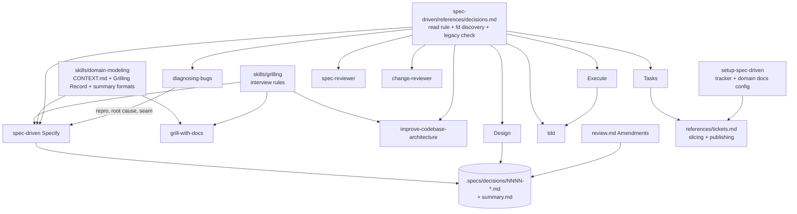

# Integrate Skills Design

**Spec**: `.specs/features/integrate-skills/spec.md`
**Grilling Record**: `.specs/decisions/0001-integrate-grill-into-spec-driven.md` (Design section: D-0001.30 to D-0001.33)
**Status**: Draft

---

## Architecture Overview

The repository is a library of prompts plus a few deterministic scripts. Each rule gets one home, and every other file links to it.



Flow after the change:

```
Specify (grill) → Design (Medium+) → Tasks + Tickets (always) → /spec-review → Dispositions
   → ["publish tickets", optional] → Execution Approval → Execute (tdd loop per Task) → Verifier → /code-review (human)
```

---

## Code Reuse Analysis

### Reuse Table (one row per planned component)

| Planned component | Searched (terms / queries) | Nearest existing equivalent | Decision | Why |
| --- | --- | --- | --- | --- |
| `skills/grilling/SKILL.md` | `symbols --match grill,session,interview`; `rg -n grilling` | synced `anthropic-skills:grilling` (not in repo) | Reuse (vendor) + Extend | add the two escapes and the Binds rule |
| `domain-modeling/GRILLING-RECORD-FORMAT.md` | `symbols --match decision,adr,record,summary`; `rg -n ADR` | `skills/domain-modeling/ADR-FORMAT.md` | Replace | its one-paragraph rule is the cause of tiny files |
| `spec-driven/references/decisions.md` | `symbols --match discover,scan,listing,tree`; `rg -n "AD-NNN\|docs/adr"` | `memory.md` Decisions section; scattered ADR read lines in 6 skills | New (consolidates) | one read rule instead of ten copies |
| Specify grill flow in `specify.md` | `rg -n "Discuss\|pace"` | `references/discuss.md`, `specify.md` step 1 | Extend `specify.md`, delete `discuss.md` | Discuss folds into the grill |
| `spec-driven/references/tickets.md` | `symbols --match ticket,tracker,issue,publish`; `rg -n "to-tickets"` | `skills/to-tickets/SKILL.md` | Move + Extend | keep vertical slices, expand–contract and per-tracker shapes; resize to one day |
| `setup-spec-driven` | `rg -n setup-matt-pocock` | `skills/setup-matt-pocock-skills/` | Rename + trim | drop triage labels, ADR wording |
| Ticket checks in `validate_tasks.py` | read `validate_tasks.py` | `parse_tasks`, `check` | Extend | a second pass over a `## Tickets` section |
| Plan-file gate and snapshot in `prep_review.py` | read `prep_review.py:206-260` | `prep_spec`, plan list at `:212` | Extend | add paths, add two STOP checks, list records |
| Section rename in `validate_spec.py` | read `validate_spec.py:44-60,196-225` | `REQUIRED_SECTIONS`, assumptions table check | Extend | rename, require at every scope, accept `none` |
| Retired-skill removal in `install.sh` | `symbols --match retire,retired,install` → none; read `install.sh:13,24-28` | `RETIRED_SKILLS` loop | Extend | longer list, fd warning |
| `tests/` | `find . -name 'test_*.py'` → none; `python3 -m pytest` → not installed | none | New | stdlib `unittest`, fixture repositories in temp dirs (D-0001.30) |

### Integration Points

| System | Integration Method |
| --- | --- |
| Claude Code | skills copied to `~/.claude/skills/` by `install.sh`; reviewer agents rendered by `render-adapters.js` |
| opencode | reads `~/.claude/skills/`; agents and `/spec-review`, `/code-review` commands rendered by `render-adapters.js` (unchanged) |
| omp | reads `~/.claude/` files; Specify's sibling-path fallback covers skill loading |
| Issue trackers | `references/tickets.md` reads `docs/agents/issue-tracker.md` written by `setup-spec-driven` (GitHub `gh`, GitLab `glab`, local markdown, or a freeform description) |

---

## Components

### `skills/grilling/` (new, vendored)

- **Purpose**: the interview primitive: one question per turn, a recommendation per question, facts looked up and decisions asked.
- **Location**: `skills/grilling/SKILL.md`, `skills/grilling/agents/openai.yaml`
- **Interfaces**: called by name by Specify, Design, `grill-with-docs` and `improve-codebase-architecture`.
- **Adds**: "you decide" records the recommendation as `Decided by: agent`; "decide the rest" lists every remaining default in one turn; each recommendation states its proposed Binds.

### `skills/domain-modeling/` (changed)

- **Purpose**: owns the glossary format and the Grilling Record and `summary.md` formats; writes them during any grill.
- **Location**: `SKILL.md` rewritten; `GRILLING-RECORD-FORMAT.md` new (record template plus `summary.md` template); `ADR-FORMAT.md` deleted; `CONTEXT-FORMAT.md` unchanged.
- **Interfaces**: called by name with `grilling`. The record template spells out completeness rules in prose (D-0001.6): every section required; the Session path lists every option offered, including rejected ones and retries; every Decision has a trade-off; and "a record shorter than its session is wrong".

### `skills/spec-driven/references/decisions.md` (new)

- **Purpose**: the read rule, discovery, legacy check and Binds test, in one place (D-0001.33).
- **Interfaces**: linked from `specify.md`, `design.md`, `tasks.md`, `implement.md`, `standards.md` §1, both agents, `tdd`, `diagnosing-bugs`, `improve-codebase-architecture`, `domain-modeling`.
- **Contents**: the two fd commands; the "fd missing: stop and ask" rule; the `summary.md` row filter; the legacy `docs/adr/` and `STATE.md` check; "cite outside sources used in the record's Context".

### spec-driven phase references (changed)

- `SKILL.md`: flow line, auto-sizing table (Tasks at every scope, Design at Medium+), `.specs` tree (`decisions/`, no `context.md`), commands table (publish tickets; Discuss removed), Critical Rules (implementation only through spec-driven; Tickets published only on go-ahead).
- `specify.md`: pre-question steps (lessons, `decisions.md` read rule, capability search, Standards); calls `grilling` + `domain-modeling`, with the sibling fallback; dimensions sweep as closing branches; incremental record; spec template with `## Decisions & Assumptions` (`ID | Decision | Choice | Rationale | Decided by | Binds`), Deferred Ideas in Out of Scope and optional `## References`; Small template gains Decisions & Assumptions.
- `discuss.md`: deleted.
- `design.md`: required at Medium+; reads via `decisions.md`; grill-style questions; `## Design` section in the record; Tech Decisions as links; supersede flow via the record.
- `tasks.md`: never skipped; top-down Ticket slicing (D-0001.23) with the `## Tickets` markup (D-0001.31); links `tickets.md`.
- `tickets.md` (new): slicing rules (about one day, vertical, expand–contract for wide refactors) and publishing (D-0001.25: explicit "publish tickets", Dispositions first, IDs written back, drift listed).
- `implement.md`: no safety valve; per-Task `tdd` loop; deferred ideas surfaced, Out of Scope row on go-ahead; after the Verifier passes, say `/code-review` is available.
- `memory.md`: `STATE.md` keeps `## Handoff`; the Decisions section moves to a pointer at `decisions.md`.
- `standards.md` §1: active project Decisions are Repo Standards; discovery replaces the hand-listed source search.
- `review.md`: Amendments step after Dispositions (D-0001.15); publish-tickets gate.
- `finding-format.md`, `coding-principles.md`: ADR and `AD-NNN` wording replaced.

### Scripts (changed)

- `validate_spec.py`: `REQUIRED_SECTIONS` and `REQUIRED_SECTIONS_SMALL` both contain `Decisions & Assumptions`; the cell check reads the new table (Choice and Rationale filled) and accepts a section whose body is `none`.
- `validate_tasks.py`: a Ticket pass over `## Tickets`: every task in exactly one Ticket; Blocked by points only to earlier Tickets. `Tickets` joins `REQUIRED_SECTIONS`.
- `prep_review.py`: plan list adds `.specs/decisions/` and `CONTEXT.md`; STOP when `tasks.md` is missing, or `design.md` at Medium+; the Review context lists records whose `summary.md` row names the feature; `context.md` and the `STATE.md` decisions line are dropped.

### Agents (changed)

- `agents/spec-reviewer.md`: reads via `decisions.md`; adds the D-0001.20 checks.
- `agents/change-reviewer.md`: reads via `decisions.md`; adds the active-Decision and departure checks.

### Other skills (changed or removed)

- `tdd`: description and intro become "the test-first loop spec-driven Execute runs per Task"; seams come from Scenarios and Design; ADR line becomes a `decisions.md` link.
- `diagnosing-bugs`: Phase 5 becomes "hand off to a Small Specify"; ADR line becomes a `decisions.md` link.
- `improve-codebase-architecture` (+ `HTML-REPORT.md`, `agents/openai.yaml`): ADR conflicts become Decision conflicts; rejections are recorded in its Grilling Record.
- `grill-with-docs` (+ `agents/openai.yaml`): description says it writes a Grilling Record and `CONTEXT.md`; for features, use spec-driven.
- `setup-spec-driven`: renamed from `setup-matt-pocock-skills`; Section B (triage labels) and `triage-labels.md` removed; `domain.md` points at `.specs/decisions/`.
- Deleted: `ask-matt`, `implement`, `to-spec`, `to-tickets`, `triage`, `wayfinder`, `skills/engineering-README.md`.

### Install and docs (changed)

- `install.sh`: `RETIRED_SKILLS` gains the seven names; warns when `fd` is missing; the step list stays otherwise.
- `README.md`: skill table and flow rewritten; attribution reads "based on mattpocock/skills"; `engineering-README.md` mention removed.

---

## Data Models

### Grilling Record (`.specs/decisions/NNNN-slug.md`)

```markdown
# NNNN · <title>
- **Date** · **Started from** · **Specs** · **Binds** · **Areas** · **Status**
## Context            (problem, forces, code facts with file:line, constraints, outside sources used)
## Session path       (### Qn · question; Options; Recommended; Answer -> D-NNNN.k)
## Decisions          (### D-NNNN.k · title; Choice; Reason; Trade-off; Binds · Decided by · Status)
## Design             (feature records only, appended by Design)
## Amendments         (appended when a Disposition changes a Decision)
## Consequences
## Related
```

### `summary.md`

```markdown
| File | Summary | Status | Binds | Areas | Specs |
## Legacy decision paths   (one line per docs/adr/ or STATE.md Decisions that exists)
```

### `tasks.md` Tickets

```markdown
## Tickets
### K1: <title>
**Delivers**: <user-visible outcome>
**Covers**: GRILL-05, GRILL-05.S1, ...
**Blocked by**: none | K<n> (earlier only)
**Tasks**: T1, T2, T3
**Tracker**: <issue ID after publishing>
```

---

## Error Handling Strategy

| Error Scenario | Handling | User Impact |
| --- | --- | --- |
| `fd` missing at runtime | agent stops and asks to install it | one extra step on a fresh machine |
| `fd` missing at install | `install.sh` warns and continues | warning line in install output |
| harness cannot load a skill by name | Specify reads the sibling `SKILL.md` | none |
| `tasks.md` or (Medium+) `design.md` missing at review | `prep_review.py` prints `STOP: ...`, exit 1 | `/spec-review` shows the STOP verbatim |
| "publish tickets" with pending Dispositions | agent refuses, lists pending Findings | nothing published |
| no `summary.md`, legacy `docs/adr/` present | read rule still checks legacy paths | none |

---

## Risks & Concerns

| Concern | Location (file:line) | Impact | Mitigation |
| --- | --- | --- | --- |
| Thin Grilling Records despite the template | `skills/domain-modeling/ADR-FORMAT.md:15` (the old cause) | lost "why" | explicit completeness prose in the new template; spec-reviewer Communication check (REV-05) |
| Agent-behavior Scenarios not re-checked automatically | spec Success Criteria | regressions in prompts go unnoticed | UAT walkthrough recorded per Scenario in `validation.md` (D-0001.30) |
| Four non-spec-driven skills depend on a sibling path | D-0001.33 | broken link if spec-driven is not installed | `install.sh` always installs spec-driven with the rest |
| Installed old validator rejects this spec's new heading | `validate_spec.py:48` | one expected error until T2 lands | recorded in the spec's Assumptions table |
| `install.sh` test could install graphify over the network | `install.sh:49-54` | slow or failing tests | tests put a stub `graphify` and stub `uv` on PATH |

---

## Tech Decisions

| Decision | See |
| --- | --- |
| Test strategy | [D-0001.30](../../decisions/0001-integrate-grill-into-spec-driven.md#d-000130--test-strategy-for-a-prompt-and-script-repository) |
| Ticket markup | [D-0001.31](../../decisions/0001-integrate-grill-into-spec-driven.md#d-000131--ticket-markup-in-tasksmd) |
| Mandatory plan files at review | [D-0001.32](../../decisions/0001-integrate-grill-into-spec-driven.md#d-000132--prep_reviewpy-gates-the-mandatory-plan-files) |
| Home of the read rule | [D-0001.33](../../decisions/0001-integrate-grill-into-spec-driven.md#d-000133--one-home-for-the-read-rule-and-discovery) |
