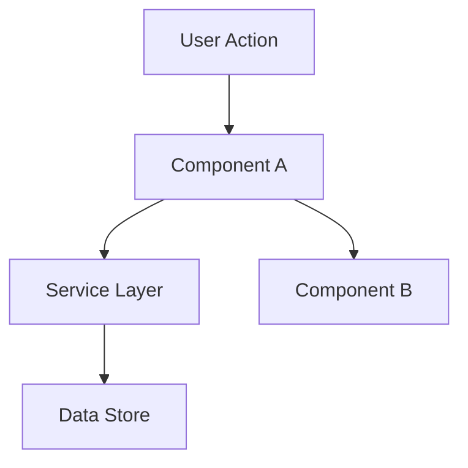

# Design

**Goal**: Define HOW to build it. Architecture, components, what to reuse.

**Design is required at Medium scope and above.** A Medium, Large or Complex feature always gets a `design.md`; `/spec-review` stops when it is missing. A Small feature skips Design when the change holds no architectural choice; if a Small change does force one (a new pattern, a new component, a choice between two structures), run Design for it.

How deep it goes depends on the scope:

- **Medium**: `design.md` holds the components, the reuse table and the links to its Decisions. The other template sections are filled only when they have content. The approach question (step 2) is asked only when real alternatives exist.
- **Large / Complex**: every template section, and the approach question is always asked.

Design makes choices, and every choice is a **Decision**. Design does not keep a decision log of its own: it writes each Decision into the feature's **Grilling Record**, under a `## Design` section, and `design.md` links to it. Design never writes an ADR file, never writes to `docs/adr/`, and never adds an `AD-NNN` entry to `.specs/STATE.md`. Those are legacy decision sources: they are read, and never written to again.

`<skill-dir>` below is the `spec-driven` skill directory.

## Process

### 1. Load Context

Do all of this before the first design choice.

**1.1 Read the spec and its Grilling Record.** Read `.specs/features/[feature]/spec.md`, then the record its `**Grilling Record**:` line links (`.specs/decisions/<slug>.md`). The record holds the full text of every Decision the grill made, with the options the user rejected. In the spec's `## Decisions & Assumptions` table, a row with Decided by `user` is locked: design within it. A row with Decided by `agent` may be revisited here, but only as a recorded change (step 6).

**1.2 Find the Decisions that bind this design.** Follow [decisions.md](decisions.md) from top to bottom, exactly as Specify did: discovery (stop and ask when `fd` is missing), `summary.md` and the `active` records that bind the project in the areas this design touches, the header fallback when the index is broken, and every legacy decision source that exists (root and per-context `docs/adr/`, `.specs/STATE.md` `## Decisions`, and this feature's `context.md` when the folder has one). Design runs later than Specify and touches more paths than the spec named, so run the read rule again for the paths the design will touch; do not rely on what Specify opened.

Every active project-binding Decision, and every active legacy decision that sets a rule for the code, is a constraint this design must conform to. When what is best for this feature conflicts with one, there are two options, and both are explicit:

1. **Conform** - design within the Decision.
2. **Change it** - put the conflict to the user as one grill question, naming the Decision by ID. Only the user changes a Decision. If the user chooses to change it, rewrite it where it lives (step 6).

Silently ignoring an active Decision is not an option - it creates invisible inconsistency across features.

**1.3 Load confirmed lessons** relevant to this feature: `python3 <skill-dir>/scripts/lessons.py list --status confirmed` (filter with `--scope`/`--query`). These are past verification failures distilled into guidance - apply them while designing. Load only `confirmed`. Skip silently if no store or no code tool. See [lessons.md](lessons.md).

**1.4 Load the two sibling skills.** Design asks its questions by the `grilling` rules and writes Decisions in the format `domain-modeling` owns. Load `grilling` and `domain-modeling` by name with your harness's skill tool. If the harness offers no such tool, or the load fails, read `<skill-dir>/../grilling/SKILL.md`, `<skill-dir>/../domain-modeling/SKILL.md` and `<skill-dir>/../domain-modeling/GRILLING-RECORD-FORMAT.md` instead.

### 1.5. Research (Optional but Recommended)

If the feature involves unfamiliar technology, patterns, or integrations, research before designing. Document findings briefly in the design doc or as inline notes. This prevents incorrect assumptions from propagating into tasks.

Follow the **Knowledge Verification Chain** (see SKILL.md) in strict order:

```
Codebase → Project docs → Context7 MCP → Web search → Flag as uncertain
```

**CRITICAL: NEVER assume or fabricate information.** If you cannot find an answer through the chain, explicitly say "I don't know" or "I couldn't find documentation for this". Inventing an API, a pattern, or a behavior that doesn't exist is far worse than admitting uncertainty. Wrong assumptions propagate through design → tasks → implementation and cause cascading failures.

Good triggers for research: new libraries, unfamiliar APIs, performance-sensitive features, security-sensitive features, patterns you haven't used in this codebase before.

**Concern flagging (MUST do while reading code):** While walking the codebase via the Knowledge Verification Chain, flag any concerns you encounter in the areas this feature touches. Capture each finding in the `## Risks & Concerns` section of `design.md`:

- **Fragile code** - tight coupling, large functions, implicit state
- **Tech debt** - hacks, workarounds, deprecated APIs
- **Security risks** - unvalidated input, auth gaps, exposed secrets
- **Performance bottlenecks** - N+1 queries, unbounded loops, missing indexes
- **Test coverage gaps** - untested paths the feature depends on

Every flagged concern MUST include a mitigation - how the design (or a follow-up task) addresses it.

### 2. Define Architecture

**Design questions are grill questions.** Whenever a design choice is the user's to make, ask it by the `grilling` rules: one question per turn, concrete options, exactly one recommended option with its reasoning, and what the answer would bind (`project` or `feature`, by the Binds test in [decisions.md](decisions.md) section 5). "You decide" and "decide the rest" work as they do in Specify. Facts you can look up (what the code does, what a library offers) you look up through the Knowledge Verification Chain; you do not ask them.

**The approach choice is one question.** Present 2-3 viable approaches as the options of a single question, with their trade-offs, and lead with your recommendation to avoid analysis paralysis. All approaches must deliver the same scoped thing (no alternative scopes). Wait for the answer before detailing components.

- **Large / Complex:** always ask it.
- **Medium:** ask it only when real alternatives exist. When one approach is plainly right, take it and record it as a Decision with `Decided by: agent`.

Then write the overview of how the components interact. Use mermaid diagrams when helpful.

### 3. Identify Code Reuse

**CRITICAL**: What existing code can we leverage? Every planned component gets a search for an existing equivalent before it is designed as new ([standards.md](standards.md) section 4: graphify, `graph_queries.py symbols` with concept words and synonyms, `rg`). Fill the reuse table in the template: a planned component that duplicates existing behavior under a new name is a **Semantic Duplicate**, and the Spec Reviewer will check every "new" row.

The design also conforms to the Repo Standards listed in the spec's `## Standards` section.

Flag any concerns found here per step 1.5 into `## Risks & Concerns`.

### 4. Define Components and Interfaces

Each component: Purpose, Location, Interfaces, Dependencies, What it reuses.

### 5. Define Data Models

If the feature involves data, define models before implementation.

### 6. Record every Design Decision in the Grilling Record

Every choice Design makes goes into the feature's Grilling Record, the same file Specify wrote. Follow `GRILLING-RECORD-FORMAT.md` in `domain-modeling`. Write as you go, not at the end: the record is what survives a compaction or a pause.

- **Where.** Add a `## Design` section to the record the first time Design decides something. It sits after `## Decisions` and before `## Review`, `## Consequences` and `## Related`. The record stays `Status: active`.
- **The next Decision ID.** Design Decisions continue the record's numbering. Find the highest `D-<slug>.k` anywhere in the file and use `k + 1`. A record that ends at `D-csv-export.6` gets `D-csv-export.7` as its first Design Decision. IDs are never reused or renumbered.
- **The same shape as any Decision.** Each one states Choice, Reason, Trade-off, Binds and Decided by, and holds exactly one choice. For example, when Design chooses to stream rows instead of building the file in memory:

  ```md
  ## Design

  ### D-csv-export.7 · Rows are streamed to the response
  - **Choice**: the export streams rows to the response as it reads them; it never builds the whole file in memory.
  - **Reason**: an export can hold more rows than fit in memory.
  - **Trade-off**: an error halfway through leaves the user with a partial download.
  - **Binds**: feature · **Decided by**: user
  ```

- **Agent-only choices are Decisions too.** A choice you made without asking (the Medium approach with no real alternative, a choice the user handed over with "you decide") is recorded the same way, with `Decided by: agent`, so the Spec Reviewer can see it.
- **Questions go into the Session path.** Each design question you asked is appended to the record's Session path under a subsection `### Design (<date>)`: the question, every option offered, the recommendation and the answer, written before the next question is shown. The earlier Session path is never rewritten.
- **A Decision that binds the project** (a convention, pattern or constraint a future feature has to follow or knowingly change) is recorded in exactly the same place, with `Binds: project`. It does not go anywhere else: no new file under `docs/adr/`, no `AD-NNN` entry in `.specs/STATE.md`. This holds even in a repository that already has `docs/adr/` or a `## Decisions` section in `STATE.md`; those stay as they are. When the record's first project-binding Decision is added, set the record's `Binds` header to `project`.
- **Keep the record and its index current.** Add to the record's Consequences and Related what Design changed, cite in its Context every outside source Design used (by path, with its commit or date), extend `Areas` in the header when the design governs new paths, and update the record's row in `.specs/decisions/summary.md` whenever its Summary, Binds or Areas changed.
- **Link from `design.md` and from the spec.** `design.md` names the record on its `**Grilling Record**:` line, and its `## Tech Decisions` table has one row per Decision this design depends on, each linking to that Decision's anchor in the record (`D-csv-export.7` in the example). The table holds links, not the Decision text: the record is the one place the text lives. Add the same Decisions as rows of the spec's `## Decisions & Assumptions` table, linked the same way, then re-run `python3 <skill-dir>/scripts/validate_spec.py <feature>`.

**Changing an existing Decision.** A Decision is never overridden by writing a newer one beside it. It is rewritten where it lives, and gains one line: `- **Changed**: <YYYY-MM-DD> by <feature> (<source>): <what changed>`. For a change made here the source is `Design`.

- **A Decision in this feature's own record** (for example a Specify Decision marked `Decided by: agent` that Design revisits): rewrite its Choice, and its Reason and Trade-off where they changed, in place, and add the `Changed` line. Update its row in the spec. A `Decided by: user` Decision changes only when the user says so.
- **A Decision in another record** (step 1.2, option 2): rewrite it in that other record, with a `Changed` line naming this feature. If `billing-retries.md` holds `D-billing-retries.2` "retry three times" and the Design of `invoice-pdf` decides, with the user, to retry five times, then `D-billing-retries.2` in `billing-retries.md` now chooses five retries and carries `Changed: <date> by invoice-pdf (Design): three retries became five`. This feature's record mentions the change in its Session path and lists the changed ID under Related. It does not restate the old choice as a new Decision of its own, and `design.md` links to the Decision in the other record. Update the other record's `summary.md` row if its Summary or Areas changed.
- **A legacy decision** (an ADR file, an `AD-NNN` entry, a line of `context.md`): legacy sources are never edited. When the user decides to depart from one, record the new choice as a Decision under `## Design` in this feature's record, name the legacy decision it departs from in the Choice, and list that file or entry under Related.
- Never mark a Decision as replaced or outdated, never give one a status of its own, and never append an amendment below it.

---

## Template: `.specs/features/[feature]/design.md`

````markdown
# [Feature] Design

**Spec**: `.specs/features/[feature]/spec.md`
**Grilling Record**: `.specs/decisions/[slug].md` (Design section: D-[slug].[k] to D-[slug].[n])
**Status**: Draft | Approved

---

## Architecture Overview

[Brief description of the architecture approach]


````

---

## Code Reuse Analysis

### Reuse Table (one row per planned component)

| Planned component | Searched (terms / queries) | Nearest existing equivalent | Decision | Why |
| ----------------- | -------------------------- | --------------------------- | -------- | --- |
| [ComponentName]   | `symbols --match a,b,c`; `graphify query "..."` | `src/path/file.ts:42` [symbol] or none | Reuse / Extend / New | [what differs, if New] |

### Integration Points

| System         | Integration Method                      |
| -------------- | --------------------------------------- |
| [Existing API] | [How new feature connects]              |
| [Database]     | [How data connects to existing schemas] |

---

## Components

### [Component Name]

- **Purpose**: [What this component does - one sentence]
- **Location**: `src/path/to/component/`
- **Interfaces**:
  - `methodName(param: Type): ReturnType` - [description]
  - `methodName(param: Type): ReturnType` - [description]
- **Dependencies**: [What it needs to function]
- **Reuses**: [Existing code this builds upon]

### [Component Name]

- **Purpose**: [What this component does]
- **Location**: `src/path/to/component/`
- **Interfaces**:
  - `methodName(param: Type): ReturnType`
- **Dependencies**: [Dependencies]
- **Reuses**: [Existing code]

---

## Data Models (if applicable)

### [Model Name]

```typescript
interface ModelName {
  id: string
  field1: string
  field2: number
  createdAt: Date
}
```

**Relationships**: [How this relates to other models]

### [Model Name]

```typescript
interface AnotherModel {
  id: string
  // ...
}
```

---

## Error Handling Strategy

| Error Scenario | Handling      | User Impact      |
| -------------- | ------------- | ---------------- |
| [Scenario 1]   | [How handled] | [What user sees] |
| [Scenario 2]   | [How handled] | [What user sees] |

---

## Risks & Concerns

| Concern | Location (file:line) | Impact | Mitigation |
| ------- | -------------------- | ------ | ---------- |
| [Fragile code / tech debt / security / perf / test gap] | `src/path/file.ts:42` | [What breaks or degrades] | [How the design or a follow-up task addresses it] |

> None found - is a valid entry.

---

## Tech Decisions

Links only. The full text of each Decision (choice, reason, trade-off, Binds, Decided by) lives in the Grilling Record. One row per Decision this design depends on: every Decision recorded under the record's `## Design` section, plus any Decision in another record that this design changed.

| Decision          | See |
| ----------------- | --- |
| [What was decided, in a few words] | [D-[slug].7](../../decisions/[slug].md#[anchor]) |
| [A Decision of another record this design changed] | [D-[other-slug].2](../../decisions/[other-slug].md#[anchor]) |

**The Decision link.** A row links to the Decision's heading in the record. For the heading `### D-csv-export.7 · Rows are streamed to the response` the link is `../../decisions/csv-export.md#d-csv-export7--rows-are-streamed-to-the-response`: the heading in lowercase, punctuation dropped, each space turned into a hyphen.

---

## Tips

- **Load context first** - the spec, its Grilling Record, and everything the read rule in [decisions.md](decisions.md) finds; `Decided by: user` Decisions are locked
- **Every choice is a Decision in the record** - under `## Design`, with the next ID; `design.md` only links to it
- **Change a Decision where it lives** - rewrite it in its own record with a `Changed` line; never write a newer one beside it
- **Research when uncertain** - 5 minutes of research prevents hours of rework
- **Reuse is king** - Every component should reference existing patterns
- **Interfaces first** - Define contracts before implementation
- **Keep it visual** - Diagrams save 1000 words
- **Small components** - If component does 3+ things, split it
- **Flag concerns inline** - Risks found during research go in Risks & Concerns with a mitigation
- **Search before you design** - every "New" row in the reuse table cites the search that found no equivalent
- **Agreement is provisional** - the user agreeing to the design means "continue to Tasks", never "build"; building waits for `/spec-review` and Execution Approval ([review.md](review.md))
